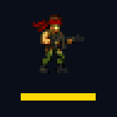

# СТАЛЕВИЙ РЕЙД

8-бітний run-and-gun у стилі Денді. Один офлайн HTML-файл: без бібліотек, без мережі, без збірки.
10 етапів, 4 боси, 5 видів зброї, FPV-дрони та укриття.

## Керування

**Телефон** — хрестовина внизу ліворуч (рух і напрямок пострілу), **ВОГОНЬ** і **СТРИБОК** праворуч.
Вогонь стріляє сам, поки тримаєш кнопку. Меню, звук і складність — у паузі.

**Клавіатура** — стрілки: рух і приціл, `Z` або пробіл: вогонь, `X`: стрибок, `P`: пауза.

## Як грати

- Одне влучання — і життя згоряє. Провалля вбивають.
- Униз стоячи — лягти, униз у стрибку — вогонь донизу, стрибок + униз — зіскочити з платформи.
- Кулі гаснуть об землю, тож за рельєфом можна ховатись.
- Ящики розстрілюються, іноді з них випадає зброя.
- Капсула, що пролітає на рівні грудей, несе зброю — збий її. Колір рамки = вид зброї.
- **Кущі й укриття**: поки стоїш у них — тебе не бачать. Вистрілиш — видаси себе.
- **FPV-дрон**: банер блимає п'ять разів до його підльоту. Встигни в укриття або збий його.
- Пройшов етап без жодної смерті — множник очок росте до ×5.

## Складність

- **НОВАЧОК** — 5 життів, світ рухається на чверть повільніше, ворогів на третину менше.
- **КЛАСИКА** — 3 життя, повна швидкість, повний склад.

Після першої перемоги в меню відкривається **BOSS RUSH** — чотири боси поспіль.

## Публікація на GitHub Pages

1. Створи репозиторій і залий у нього всі файли **в корінь**, без папок.
2. Settings → Pages → Source: `Deploy from a branch`, гілка `main`, папка `/ (root)`.
3. Через хвилину сторінка буде за адресою `https://<твій-нік>.github.io/<репозиторій>/`.
4. На iPhone: відкрий адресу в Safari → Поділитись → **На початковий екран**. Далі працює офлайн як застосунок.

## Файли

| Файл | Призначення |
|---|---|
| `index.html` | уся гра: код, графіка, звук |
| `manifest.webmanifest` | іконка й назва при встановленні на телефон |
| `sw.js` | офлайн-кеш для GitHub Pages |
| `icon-192.png`, `icon-512.png` | іконки застосунку |

`index.html` самодостатній: його можна відкрити з файлів телефона без інтернету й без решти файлів.

## Збереження

Етап, рекорд очок і рекорди часу кожного етапу зберігаються в пам'яті браузера (localStorage).
